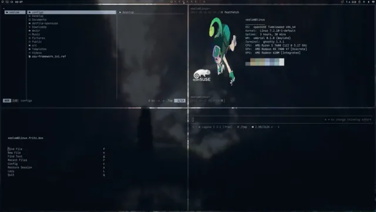
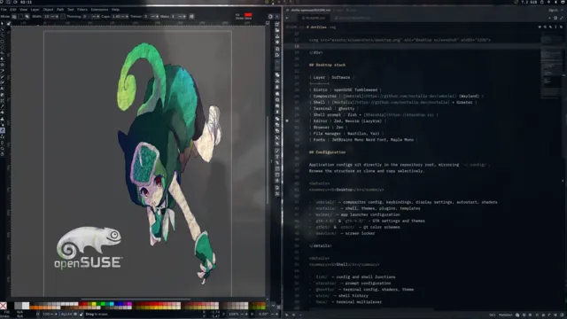
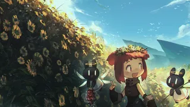
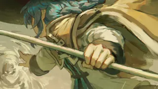
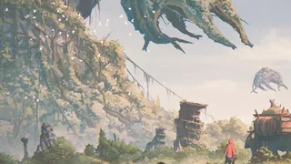

# dotfiles

**openSUSE Tumbleweed · Umbriel + Noctalia · Wayland**

## Desktop stack

| Layer | Software |
|---|---|
| Distro | openSUSE Tumbleweed |
| Compositor | [Umbriel](https://github.com/noctalia-dev/umbriel) (Wayland) |
| Shell | [Noctalia](https://github.com/noctalia-dev/noctalia) + Greeter |
| Terminal | ghostty |
| Shell prompt | fish + [Starship](https://starship.rs) |
| Editor | Zed, Neovim (LazyVim) |
| Browser | Zen |
| File manager | Nautilus, Yazi |
| Fonts | JetBrains Mono Nerd Font, Maple Mono |

## Configuration

Application configs live in `Config/`, mirroring `~/.config/`.
Browse the structure or clone and copy selectively.

<b>Desktop</b>

- `umbriel/` — compositor config, keybindings, display settings, autostart, shaders
- `noctalia/` — shell, themes, plugins, templates
- `walker/` — app launcher configuration
- `gtk-3.0/` & `gtk-4.0/` — GTK settings and themes
- `qt5ct/` & `qt6ct/` — Qt color schemes
- `swaylock/` — screen locker
- `default-app/` — role dispatcher (`roles.toml` + `default-app` script: script → `~/.local/bin/`, roles → `~/.config/default-app/`)

<b>Shell</b>

- `fish/` — config and shell functions
- `starship/` — prompt configuration
- `ghostty/` — terminal config, shaders, theme
- `atuin/` — shell history
- `tmux/` — terminal multiplexer

<b>Development</b>

- `nvim/` — Neovim with LazyVim
- `zed/` —  IDE
- `yazi/` — file manager
- `opencode/` — OpenCode agent harness
- `omp/` — Oh my Pi agent harness
- `pi/` — Pi coding agent harness

<b>Wallpapers</b>

View all wallpapers in [`assets/wallpapers/`](assets/wallpapers/).

 

