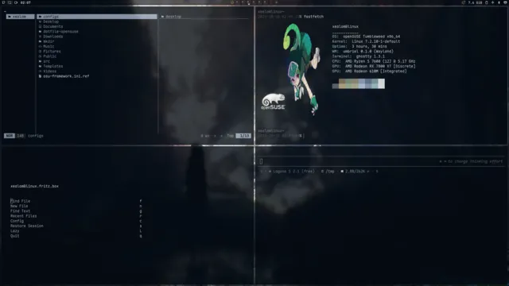
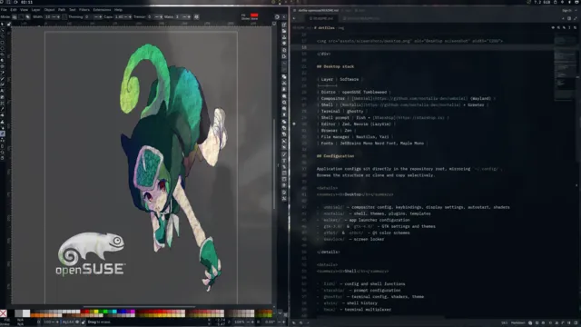
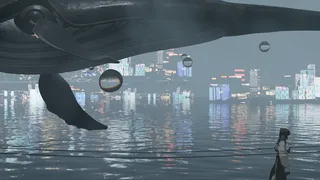
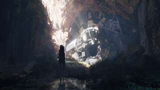
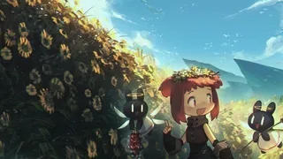
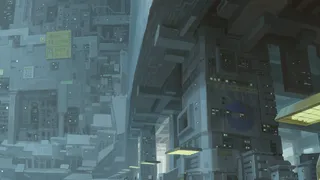
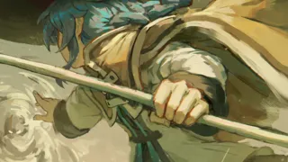
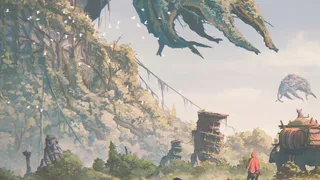
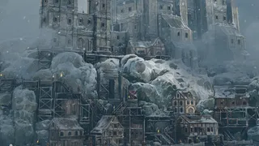

<div align="center">

# dotfiles

**openSUSE Tumbleweed · Umbriel + Noctalia · Wayland**


[](https://github.com/ghostty-org/ghostty)

<a href="assets/screenshots/desktop.png"></a>

<a href="assets/screenshots/desktop-gui.png"></a>

</div>

---

## Desktop stack

| Layer | Software |
|---|---|
| Distro | openSUSE Tumbleweed |
| Compositor | [Umbriel](https://github.com/noctalia-dev/umbriel) (Wayland) |
| Shell | [Noctalia](https://github.com/noctalia-dev/noctalia) + Greeter |
| Terminal | ghostty |
| Shell prompt | fish + [Starship](https://starship.rs) |
| Editor | Zed, Neovim (LazyVim) |
| Browser | Zen |
| File manager | Nautilus, Yazi |
| Fonts | JetBrains Mono Nerd Font, Maple Mono |

---

## Quick start

`Config/` mirrors `~/.config/` — copy selectively, don't blindly overwrite:

```bash
git clone https://github.com/Malte-Dzierzon/dotfile-opensuse.git dotfiles
cp -r dotfiles/Config/fish ~/.config/fish
```

Two special cases:

- `default-app`: copy the `default-app` script to `~/.local/bin/`, `roles.toml` to `~/.config/default-app/`
- `kittytune`: copy the `kittytune` script to `~/.local/bin/`, `kittytune.desktop` to `~/.local/share/applications/` (XWayland resize fix, see `Config/kittytune/README.md`)
- `ghostty`: needs fonts + cursor shaders — see [setup notes](Config/ghostty/README.md)

---

## Configuration

<details>
<summary><b>Desktop</b></summary>

- `umbriel/` — compositor, keybindings, displays, autostart, shaders
- `noctalia/` — shell, themes, plugins, templates
- `walker/` — app launcher
- `gtk-3.0/` & `gtk-4.0/` — GTK settings and themes
- `qt5ct/` & `qt6ct/` — Qt color schemes
- `swaylock/` — screen locker
- `default-app/` — role dispatcher (`roles.toml` + `default-app` script)
- `kittytune/` — launcher wrapper + desktop file (XWayland resize fix)
- `mimeapps.list` — desktop file associations

</details>

<details>
<summary><b>Shell &amp; terminal</b></summary>

- `fish/` — config and functions
- `starship/` — prompt (`starship.toml` lives directly in `~/.config`)
- `ghostty/` — terminal, shaders, theme
- `foot/` — backup terminal
- `atuin/` — shell history
- `btop/` — system monitor theme
- `cava/` — visualizer
- `fastfetch/` — system info (config + theme; logo PNGs stay local)
- `kew/` — music player (`kewrc` + layouts)
- `mpd/` & `rmpc/` — music daemon + client
- `gh/` — GitHub CLI (no secrets; `hosts.yml` stays local)
- `delta/` — diff theme
- `yazi/` — file manager (+ flavors)

</details>

<details>
<summary><b>Development</b></summary>

- `nvim/` — Neovim (LazyVim)
- `zed/` — IDE
- `opencode/` — OpenCode agent harness (`service.json` stays local)
- `omp/` — Oh my Pi agent harness
- `pi/` — Pi coding agent harness (+ `oh-my-pi.jsonc`)

</details>

<details>
<summary><b>App-Liste</b></summary>

Daily-use apps and where they come from (proprietary ones link to their site):

| App | Repository |
|---|---|
| Prism Launcher | [PrismLauncher/PrismLauncher](https://github.com/PrismLauncher/PrismLauncher) |
| LM Studio | [lmstudio.ai](https://lmstudio.ai) |
| Nautilus (Files) | [GNOME/nautilus](https://gitlab.gnome.org/GNOME/nautilus) |
| GNOME Calculator | [GNOME/gnome-calculator](https://gitlab.gnome.org/GNOME/gnome-calculator) |
| Baobab (Disk Usage) | [GNOME/baobab](https://gitlab.gnome.org/GNOME/baobab) |
| GNOME System Monitor | [GNOME/gnome-system-monitor](https://gitlab.gnome.org/GNOME/gnome-system-monitor) |
| Inkscape | [inkscape/inkscape](https://gitlab.com/inkscape/inkscape) |
| Readest | [readest/readest](https://github.com/readest/readest) |
| Zed | [zed-industries/zed](https://github.com/zed-industries/zed) |
| Ghostty | [ghostty-org/ghostty](https://github.com/ghostty-org/ghostty) |
| Foot | [dnkl/foot](https://codeberg.org/dnkl/foot) |
| Chromium | [chromium/chromium](https://github.com/chromium/chromium) |
| Obsidian | [obsidian.md](https://obsidian.md) |
| Mangayomi | [kodjodevf/mangayomi](https://github.com/kodjodevf/mangayomi) |
| Zen Browser | [zen-browser/desktop](https://github.com/zen-browser/desktop) |
| ArtCraft Launcher | [storytold/craft-launcher](https://github.com/storytold/craft-launcher) |
| EffectCraft | [storytold/effectcraft](https://github.com/storytold/effectcraft) |
| PhotoCraft | [storytold/photocraft](https://github.com/storytold/photocraft) |
| VectorCraft | [storytold/vectorcraft](https://github.com/storytold/vectorcraft) |
| LightCraft | [storytold/lightcraft](https://github.com/storytold/lightcraft) |
| SoundCraft | [storytold/soundcraft](https://github.com/storytold/soundcraft) |
| Equibop | [Equicord/equibop](https://github.com/Equicord/equibop) |
| KittyTune | [alan7383/KittyTuneDesktop](https://github.com/alan7383/KittyTuneDesktop) |
| Krita | [graphics/krita](https://invent.kde.org/graphics/krita) |
| T3Code | [pingdotgg/t3code](https://github.com/pingdotgg/t3code) |
| Umbriel | [noctalia-dev/umbriel](https://github.com/noctalia-dev/umbriel) |
| Noctalia | [noctalia-dev/noctalia](https://github.com/noctalia-dev/noctalia) |
| Walker | [abenz1267/walker](https://github.com/abenz1267/walker) |
| Fish | [fish-shell/fish-shell](https://github.com/fish-shell/fish-shell) |
| Starship | [starship/starship](https://github.com/starship/starship) |
| Atuin | [atuinsh/atuin](https://github.com/atuinsh/atuin) |
| Yazi | [sxyazi/yazi](https://github.com/sxyazi/yazi) |
| Neovim (LazyVim) | [LazyVim/LazyVim](https://github.com/LazyVim/LazyVim) |
| OpenCode | [sst/opencode](https://github.com/sst/opencode) |
| omp | [can1357/oh-my-pi](https://github.com/can1357/oh-my-pi) |
| pi | [earendil-works/pi](https://github.com/earendil-works/pi) |
| btop | [aristocratos/btop](https://github.com/aristocratos/btop) |
| fastfetch | [fastfetch-cli/fastfetch](https://github.com/fastfetch-cli/fastfetch) |
| mpd | [MusicPlayerDaemon/MPD](https://github.com/MusicPlayerDaemon/MPD) |
| rmpc | [mierak/rmpc](https://github.com/mierak/rmpc) |
| gh | [cli/cli](https://github.com/cli/cli) |
| delta | [dandavison/delta](https://github.com/dandavison/delta) |
| swaylock | [swaywm/swaylock](https://github.com/swaywm/swaylock) |

</details>

---

## Wallpapers

<details>
<summary><b>Gallery</b> (15 wallpapers, click for full size)</summary>

<div align="center">

<a href="assets/wallpapers/01-summer-cloud.png"></a>
<a href="assets/wallpapers/02-whale-abyss.jpg"></a>
<a href="assets/wallpapers/04-mountain-mirror.jpg"></a>
<a href="assets/wallpapers/05-bedroom-anime.png"></a>
<a href="assets/wallpapers/06-cave-light.jpg"></a>
<a href="assets/wallpapers/07-stardust-peaks.png"></a>
<a href="assets/wallpapers/08-rain-study.jpg"></a>
<a href="assets/wallpapers/09-sunflower-girl.jpg"></a>
<a href="assets/wallpapers/10-neon-haven.jpg"></a>
<a href="assets/wallpapers/11-storm-mage.png"></a>
<a href="assets/wallpapers/12-sky-leviathans.jpg"></a>
<a href="assets/wallpapers/13-amber-gaze.png"></a>
<a href="assets/wallpapers/14-tavern-treat.jpg"></a>
<a href="assets/wallpapers/15-meadow-path.jpg"></a>
<a href="assets/wallpapers/16-frosthold.jpg"></a>

</div>

</details>
